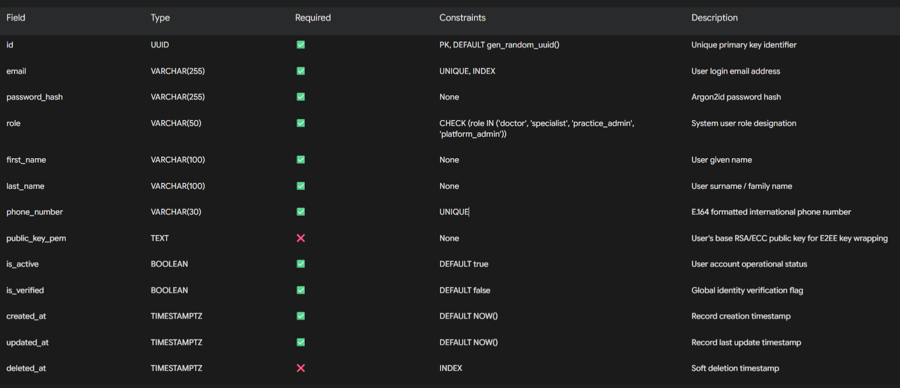
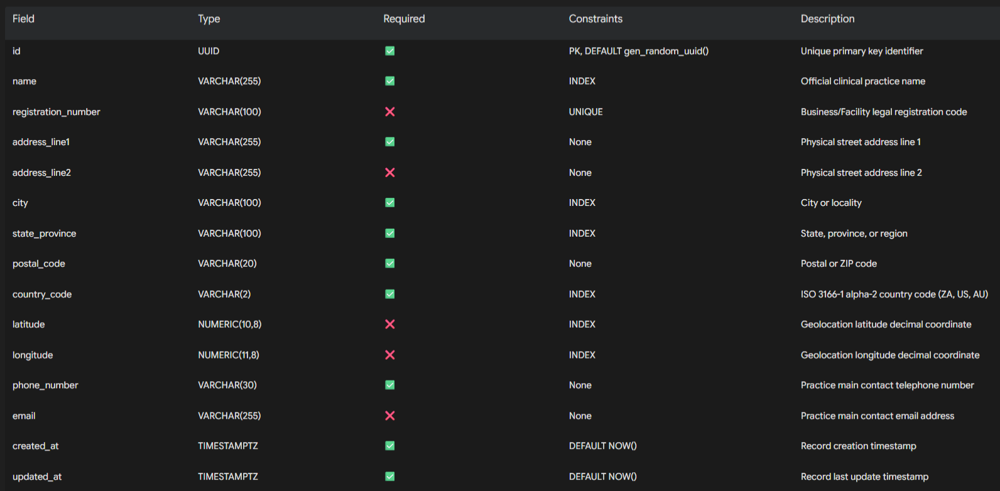
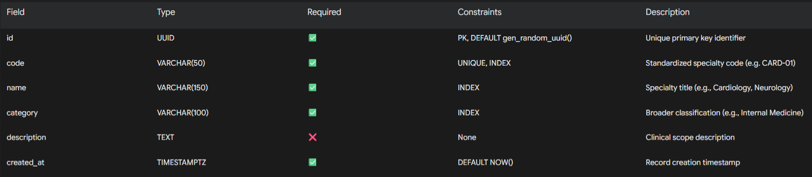
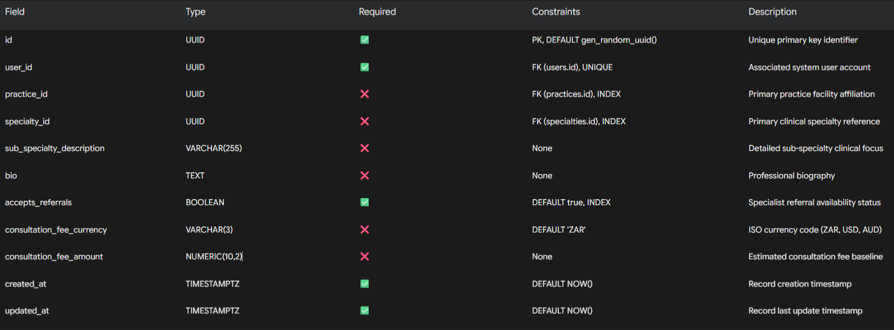
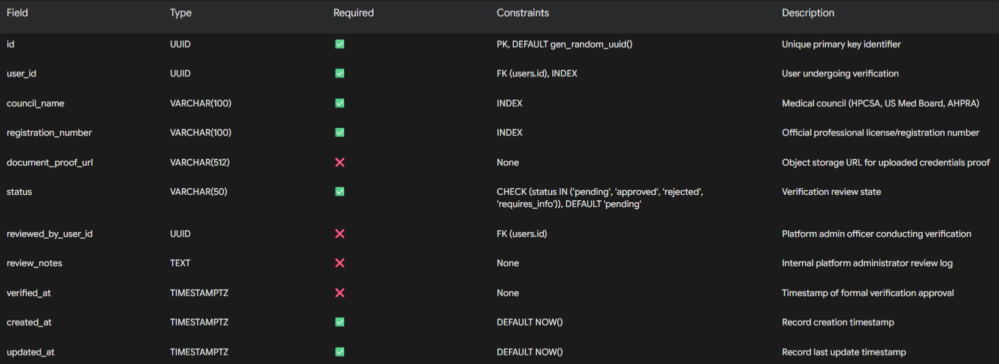
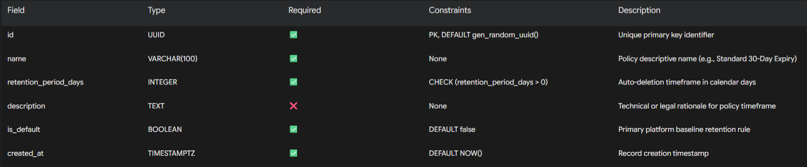

System Overview

DRPortal is a specialized referral and professional communication platform built to facilitate secure collaboration between verified medical doctors, specialists, and practice administrators. Designed as an auxiliary communication network rather than a full Electronic Health Record (EHR) or Electronic Medical Record (EMR) system, DRPortal integrates into clinical workflows to streamline patient transfers, consultations, and end-to-end encrypted document exchange across multiple jurisdictions starting with South Africa (HPCSA compliance) and expanding to the United States (HIPAA compliance) and Australia (AHPRA / Privacy Act compliance).

Core Architectural Pillars

Zero-Knowledge Zero-Trust Document Architecture (E2EE)

The backend operates purely as a secure ciphertext relay and storage node.

All sensitive clinical documentation, clinical notes attachments, and patient files are encrypted client-side (AES-GCM-256) prior to network transmission using per-document symmetric keys.

Per-document symmetric keys are encrypted (RSA-OAEP or ECDH/HKDF) using the intended recipient doctor's public key.

The DRPortal database stores only encrypted blobs, initialization vectors (IV), authentication tags, and non-PHI file metadata.

DRPortal servers never hold private key material or unencrypted file contents under any circumstance.

Compliance-Oriented Physical Deletion & Lifecycle Management

Automated retention engines continuously evaluate document TTLs against configurable platform policies.

Deletion procedures execute hard physical disk zeroization and S3/object storage payload purge operations upon document expiry or manual doctor deletion request.

Immutable referral audit trails (referral_events) are retained independently of file payloads to preserve medical-legal logging requirements while remaining stripped of PHI payloads.

Hybrid Real-Time Infrastructure

Built on FastAPI using asynchronous Python (asyncio) for high-concurrency API performance.

PostgreSQL serves as the relational single source of truth, enforcing foreign key integrity, temporal constraints, and JSON schema constraints.

Redis operates as a multi-region distributed pub/sub broker for real-time WebSockets state synchronization, online presence tracking, typing notifications, and ephemeral rate limiting.

Nginx handles TLS termination (automated via Certbot), HTTP/2 framing, WebSocket upgrading, and payload streaming limits.

Multi-Region Jurisdictional Scalability

User identities and specialist directories support multi-country registration validation (HPCSA, NPI/US Medical Board, AHPRA).

Data partitioning and retention policies are scoped by regional jurisdiction settings.

Database Architecture

The backend database is structured in PostgreSQL to ensure ACID compliance, relational integrity, robust text search capabilities, and precise audit tracking.

Key Architectural Patterns:

Primary Keys: All tables use globally unique UUIDv4 (UUID) identifiers to prevent key enumeration and enable multi-region data synchronization.

Timestamping: All timestamps utilize TIMESTAMP WITH TIME ZONE (TIMESTAMPTZ) defaulted to UTC (NOW()).

Soft Deletion vs. Physical Purge: Standard relational records support logical soft deletion via deleted_at. However, document files listed in document_deletion_queue strictly enforce physical file unlinking and database block zeroization.

Security & Integrity: Multi-column index strategies are deployed on heavy lookup fields (specialty_id, location_geog, status, assigned_specialist_id).

Entity Relationship Overview

Below is the visual structure showing entity connections across core domain domains: User Verification & Practice Directory, Referral & Consultations domain, End-to-End Encrypted Documents domain, and Realtime/Notifications domain.

+-------------------+           +-----------------------+           +-------------------+
|      users        |1---------1|    doctor_profiles    |N---------1|    specialties    |
+-------------------+           +-----------------------+           +-------------------+
  |1             |1               |N                 |N
  |              |                |                  |
  |1             |1               |1                 |1
+---+          +----+           +---+              +----+
| V |          | W  |           | X |              | Y  |
+---+          +----+           +---+              +----+
  |              |                |                  |
  v              v                v                  v
+-------------------+       +-------------------+  +-----------------------------------+
|doctor_verificats  |       |     practices     |  |   document_retention_policies     |
+-------------------+       +-------------------+  +-----------------------------------+
                                                                      |1
                                                                      |
                                                                      v N
+--------------------------------------------------------------------------------------+
|                                   referrals                                          |
+--------------------------------------------------------------------------------------+
  |1               |1                   |1                            |1
  |                |                    |                             |
  v N              v N                  v N                           v N
+--------------+ +------------------+ +-------------------------+ +--------------------+
|referral_msgs | |referral_documents| |     referral_events     | |   notifications    |
+--------------+ +------------------+ +-------------------------+ +--------------------+
                        |1
                        |
                        v 1
                 +--------------------------+
                 | document_deletion_queue  |
                 +--------------------------+

+---------------------------+ 1       N +-------------------------------+
|   direct_conversations    |-----------|  direct_conversation_members   |
+---------------------------+           +-------------------------------+
  |1                                                        |N
  |                                                         |
  v N                                                       v 1
+---------------------------+                       +-------------------+
|      direct_messages      |                       |       users       |
+---------------------------+                       +-------------------+

Table Documentation

1. users
Stores platform authentication primitives, credential hashes, multi-factor settings, global user roles, and base demographic information.

2. practices
Represents clinics, hospitals, medical facilities, or private practices where doctors and practice admins operate.

3. specialties
Lookup table defining medical and surgical sub-specialities across jurisdictions.

4. doctor_profiles
Holds extended professional details, practice affiliations, qualification credentials, and directory metadata for doctors and specialists.

5. doctor_verifications

Manages identity and medical council registration verification workflows conducted by platform administrators.

6. document_retention_policies

Defines configurable cleanup and lifespan parameters for encrypted document payloads based on system defaults or practice settings.

7. referrals

Core transactional table representing clinical patient referrals routed between doctors and specialists.

Field

Type

Required

Constraints

Description

id

UUID

✅

PK, DEFAULT gen_random_uuid()

Unique primary key identifier

referral_code

VARCHAR(30)

✅

UNIQUE, INDEX

Human-readable tracking ID (e.g. REF-2026-X89B)

referring_doctor_id

UUID

✅

FK (users.id), INDEX

Initiating physician ID

receiving_specialist_id

UUID

✅

FK (users.id), INDEX

Target specialist ID

practice_id

UUID

❌

FK (practices.id), INDEX

Receiving facility reference

status

VARCHAR(50)

✅

CHECK (status IN ('draft', 'submitted', 'accepted', 'declined', 'in_consultation', 'completed', 'cancelled')), DEFAULT 'submitted', INDEX

Lifecycle state of referral

priority

VARCHAR(20)

✅

CHECK (priority IN ('routine', 'urgent', 'emergency')), DEFAULT 'routine', INDEX

Triage urgency level

encrypted_patient_alias

TEXT

✅

None

Encrypted patient identity alias/hash for tracking

encrypted_clinical_summary

TEXT

❌

None

E2EE encrypted baseline clinical overview blob

retention_policy_id

UUID

❌

FK (document_retention_policies.id)

Enforced document lifetime policy

expires_at

TIMESTAMPTZ

❌

INDEX

Automatic payload cleanup timestamp cutoff

created_at

TIMESTAMPTZ

✅

DEFAULT NOW()

Record creation timestamp

updated_at

TIMESTAMPTZ

✅

DEFAULT NOW()

Record last update timestamp

8. referral_messages

Stores referral-bound clinical chat micro-messages and communication logs between referring doctors and assigned specialists.

Field

Type

Required

Constraints

Description

id

UUID

✅

PK, DEFAULT gen_random_uuid()

Unique primary key identifier

referral_id

UUID

✅

FK (referrals.id), INDEX

Parent referral thread reference

sender_id

UUID

✅

FK (users.id), INDEX

Message author user ID

encrypted_content

TEXT

✅

None

Base64 E2EE payload encrypted using session shared key

iv

VARCHAR(128)

✅

None

Cryptographic Initialization Vector for AES-GCM decryption

auth_tag

VARCHAR(128)

✅

None

Cryptographic authentication tag for payload integrity

is_read

BOOLEAN

✅

DEFAULT false

Receiver read status indicator

read_at

TIMESTAMPTZ

❌

None

Timestamp receiver viewed message

created_at

TIMESTAMPTZ

✅

DEFAULT NOW()

Record creation timestamp

9. referral_documents

Contains non-PHI metadata and encrypted storage handles for E2EE clinical attachments associated with referrals.

Field

Type

Required

Constraints

Description

id

UUID

✅

PK, DEFAULT gen_random_uuid()

Unique primary key identifier

referral_id

UUID

✅

FK (referrals.id), INDEX

Parent referral transaction

uploader_id

UUID

✅

FK (users.id)

Author/Uploader user ID

storage_bucket

VARCHAR(100)

✅

None

Cloud Object Storage bucket target

storage_object_key

VARCHAR(512)

✅

UNIQUE

Storage key for encrypted binary blob

encrypted_file_name

TEXT

✅

None

Client-side encrypted original file name

encrypted_symmetric_key

TEXT

✅

None

Per-document AES key, encrypted per authorized public key

mime_type

VARCHAR(100)

✅

None

Object MIME type (e.g. application/octet-stream)

file_size_bytes

BIGINT

✅

None

Size of raw cipher payload on disk

file_hash_sha256

VARCHAR(64)

✅

None

Integrity hash of encrypted ciphertext blob

iv

VARCHAR(128)

✅

None

Cryptographic Initialization Vector

retention_policy_id

UUID

❌

FK (document_retention_policies.id)

Retention configuration reference

expires_at

TIMESTAMPTZ

✅

INDEX

Physical deletion expiration cutoff

is_deleted

BOOLEAN

✅

DEFAULT false, INDEX

Flag denoting active physical deletion status

created_at

TIMESTAMPTZ

✅

DEFAULT NOW()

Record creation timestamp

10. referral_events

Immutable, non-repudiable audit logger for referral status adjustments and legal tracking. Never stores unencrypted PHI payloads.

Field

Type

Required

Constraints

Description

id

UUID

✅

PK, DEFAULT gen_random_uuid()

Unique primary key identifier

referral_id

UUID

✅

FK (referrals.id), INDEX

Associated referral transaction

actor_id

UUID

❌

FK (users.id)

User or system trigger responsible for event

event_type

VARCHAR(100)

✅

INDEX

Action code (e.g. REFERRAL_CREATED, STATUS_UPDATED, DOC_EXPIRED)

previous_state

VARCHAR(50)

❌

None

Prior status string

new_state

VARCHAR(50)

❌

None

Transitioned status string

metadata_json

JSONB

❌

None

Non-PHI operational parameters and IP/Agent audit hashes

created_at

TIMESTAMPTZ

✅

DEFAULT NOW(), INDEX

Immutable audit log timestamp

11. document_deletion_queue

Asynchronous processing queue for guaranteed zeroization and physical unlinking of expired or manually purged E2EE documents.

Field

Type

Required

Constraints

Description

id

UUID

✅

PK, DEFAULT gen_random_uuid()

Unique primary key identifier

document_id

UUID

✅

FK (referral_documents.id), UNIQUE

Targeted referral document

storage_bucket

VARCHAR(100)

✅

None

Bucket location target

storage_object_key

VARCHAR(512)

✅

None

Payload path key

status

VARCHAR(50)

✅

CHECK (status IN ('pending', 'processing', 'completed', 'failed')), DEFAULT 'pending', INDEX

Queue execution phase

retry_count

INTEGER

✅

DEFAULT 0

Processing attempt counter

error_log

TEXT

❌

None

Exception detail logging for failure analysis

scheduled_for

TIMESTAMPTZ

✅

INDEX

Execution target execution timestamp

processed_at

TIMESTAMPTZ

❌

None

Execution completion timestamp

created_at

TIMESTAMPTZ

✅

DEFAULT NOW()

Queue item entry timestamp

12. notifications

In-app real-time event alerts triggered for user updates, status shifts, and referral assignments.

Field

Type

Required

Constraints

Description

id

UUID

✅

PK, DEFAULT gen_random_uuid()

Unique primary key identifier

recipient_id

UUID

✅

FK (users.id), INDEX

Recipient target account

title

VARCHAR(255)

✅

None

Concise alert heading

body

TEXT

✅

None

In-app notification payload content

notification_type

VARCHAR(50)

✅

INDEX

Category (e.g. REFERRAL_UPDATE, VERIFICATION_APPROVED)

reference_resource_type

VARCHAR(50)

❌

None

Linked entity type (e.g. referral, direct_message)

reference_resource_id

UUID

❌

None

Target foreign key reference ID

is_read

BOOLEAN

✅

DEFAULT false, INDEX

Status indicator

read_at

TIMESTAMPTZ

❌

None

Reading acknowledgment timestamp

created_at

TIMESTAMPTZ

✅

DEFAULT NOW(), INDEX

Notification generation timestamp

13. direct_conversations

Top-level metadata container for non-referral ad-hoc peer-to-peer physician messaging channels.

Field

Type

Required

Constraints

Description

id

UUID

✅

PK, DEFAULT gen_random_uuid()

Unique primary key identifier

conversation_type

VARCHAR(50)

✅

CHECK (conversation_type IN ('direct', 'group')), DEFAULT 'direct'

Channel structure classification

title

VARCHAR(255)

❌

None

Optional name for group channels

created_by_user_id

UUID

✅

FK (users.id)

Author user ID

created_at

TIMESTAMPTZ

✅

DEFAULT NOW()

Channel creation timestamp

updated_at

TIMESTAMPTZ

✅

DEFAULT NOW()

Channel last activity timestamp

14. direct_conversation_members

Junction mapping table maintaining access permissions and participation in peer-to-peer communication channels.

Field

Type

Required

Constraints

Description

id

UUID

✅

PK, DEFAULT gen_random_uuid()

Unique primary key identifier

conversation_id

UUID

✅

FK (direct_conversations.id), INDEX

Associated messaging channel

user_id

UUID

✅

FK (users.id), INDEX

Participating user ID

role

VARCHAR(50)

✅

CHECK (role IN ('member', 'admin')), DEFAULT 'member'

Channel membership role

joined_at

TIMESTAMPTZ

✅

DEFAULT NOW()

Entry timestamp

last_read_at

TIMESTAMPTZ

❌

None

Watermark timestamp for unread badge metrics

15. direct_messages

Encrypted non-referral peer-to-peer messages exchanged inside user conversations.

Field

Type

Required

Constraints

Description

id

UUID

✅

PK, DEFAULT gen_random_uuid()

Unique primary key identifier

conversation_id

UUID

✅

FK (direct_conversations.id), INDEX

Target conversation thread

sender_id

UUID

✅

FK (users.id), INDEX

Author user ID

encrypted_content

TEXT

✅

None

E2EE encrypted message body ciphertext

iv

VARCHAR(128)

✅

None

Initialization Vector for AES-GCM scheme

auth_tag

VARCHAR(128)

✅

None

Cryptographic authentication check tag

created_at

TIMESTAMPTZ

✅

DEFAULT NOW(), INDEX

Message creation timestamp

Relationships

Parent Table

Child Table

Relationship

users

doctor_profiles

One-to-One (1:1)

users

doctor_verifications

One-to-Many (1:N)

users

doctor_verifications

One-to-Many (1:N) (via reviewed_by_user_id)

users

referrals

One-to-Many (1:N) (via referring_doctor_id)

users

referrals

One-to-Many (1:N) (via receiving_specialist_id)

users

referral_messages

One-to-Many (1:N) (via sender_id)

users

referral_documents

One-to-Many (1:N) (via uploader_id)

users

referral_events

One-to-Many (1:N) (via actor_id)

users

notifications

One-to-Many (1:N) (via recipient_id)

users

direct_conversations

One-to-Many (1:N) (via created_by_user_id)

users

direct_conversation_members

One-to-Many (1:N)

users

direct_messages

One-to-Many (1:N) (via sender_id)

practices

doctor_profiles

One-to-Many (1:N)

practices

referrals

One-to-Many (1:N)

specialties

doctor_profiles

One-to-Many (1:N)

document_retention_policies

referrals

One-to-Many (1:N)

document_retention_policies

referral_documents

One-to-Many (1:N)

referrals

referral_messages

One-to-Many (1:N)

referrals

referral_documents

One-to-Many (1:N)

referrals

referral_events

One-to-Many (1:N)

referral_documents

document_deletion_queue

One-to-One (1:1)

direct_conversations

direct_conversation_members

One-to-Many (1:N)

direct_conversations

direct_messages

One-to-Many (1:N)

Backend Development TODO

Core Models & Database Setup

[ ] Create SQLAlchemy model for users

[ ] Create Alembic migration for users

[ ] Create CRUD endpoints for users

[ ] Create SQLAlchemy model for practices

[ ] Create Alembic migration for practices

[ ] Create CRUD endpoints for practices

[ ] Create SQLAlchemy model for specialties

[ ] Create Alembic migration for specialties

[ ] Create CRUD endpoints for specialties

[ ] Create SQLAlchemy model for doctor_profiles

[ ] Create Alembic migration for doctor_profiles

[ ] Create CRUD endpoints for doctor_profiles

[ ] Create SQLAlchemy model for doctor_verifications

[ ] Create Alembic migration for doctor_verifications

[ ] Create CRUD endpoints for doctor_verifications

Retention & Policy Infrastructure

[ ] Create SQLAlchemy model for document_retention_policies

[ ] Create Alembic migration for document_retention_policies

[ ] Create CRUD endpoints for document_retention_policies

[ ] Create SQLAlchemy model for document_deletion_queue

[ ] Create Alembic migration for document_deletion_queue

[ ] Create CRUD endpoints for document_deletion_queue

Referral Domain & E2EE Document Storage

[ ] Create SQLAlchemy model for referrals

[ ] Create Alembic migration for referrals

[ ] Create CRUD endpoints for referrals

[ ] Create SQLAlchemy model for referral_messages

[ ] Create Alembic migration for referral_messages

[ ] Create CRUD endpoints for referral_messages

[ ] Create SQLAlchemy model for referral_documents

[ ] Create Alembic migration for referral_documents

[ ] Create CRUD endpoints for referral_documents

[ ] Create SQLAlchemy model for referral_events

[ ] Create Alembic migration for referral_events

[ ] Create CRUD endpoints for referral_events

Direct Messaging & Peer Consultations

[ ] Create SQLAlchemy model for direct_conversations

[ ] Create Alembic migration for direct_conversations

[ ] Create CRUD endpoints for direct_conversations

[ ] Create SQLAlchemy model for direct_conversation_members

[ ] Create Alembic migration for direct_conversation_members

[ ] Create CRUD endpoints for direct_conversation_members

[ ] Create SQLAlchemy model for direct_messages

[ ] Create Alembic migration for direct_messages

[ ] Create CRUD endpoints for direct_messages

Notifications & System Realtime Services

[ ] Create SQLAlchemy model for notifications

[ ] Create Alembic migration for notifications

[ ] Create CRUD endpoints for notifications

MVP Build Order

To minimize development blockers and ensure dependent entities are properly configured prior to integration, execute the backend implementation in the following 8 phased sprints:

[Phase 1: Base Auth & Users] ──► [Phase 2: Specialties & Practices] ──► [Phase 3: Profiles & Verification]
                                                                                     │
[Phase 6: Encrypted Documents] ◄── [Phase 5: Referral Engine] ◄── [Phase 4: Retention Policies]
              │
              ▼
[Phase 7: Realtime & Direct Messaging] ──► [Phase 8: Notifications & Worker Daemon]

Phase 1: Core Base Foundation & Auth Subsystem

Setup FastAPI application shell, database connections, and Alembic initialization.

Implement users schema, SQLAlchemy models, security utilities (Argon2id password hashing, JWT generation), and registration/login CRUD services.

Phase 2: Master Directory Enums & Facilities

Build specialties table, seed initial data for South African, US, and Australian medical councils.

Build practices table for clinical facilities, locations, and practice addresses.

Phase 3: Doctor Profiles & Administrative Verification Workflow

Build doctor_profiles linking users, practices, and specialties.

Build doctor_verifications table and platform admin approval endpoints to enforce verified status requirements.

Phase 4: Retention Engine Configuration

Build document_retention_policies to configure TTL parameters for encrypted payloads.

Phase 5: Referral Lifecycle Management & Audit Engine

Implement referrals table supporting status transitions, triage priority, and referral tracking.

Implement referral_events audit system to track all referral state modifications.

Phase 6: E2EE Secure Document Pipeline & Physical Deletion Queue

Build referral_documents table storing encrypted file metadata, initialization vectors, and object storage handles.

Build document_deletion_queue table to handle physical purging routines.

Construct background worker service to execute hard unlinks on expired or manually deleted files.

Phase 7: Consultation Chat & Direct Messaging

Implement referral_messages for E2EE chat directly attached to open referrals.

Build direct_conversations, direct_conversation_members, and direct_messages for peer-to-peer consults.

Configure Redis Pub/Sub and FastAPI WebSockets handlers for real-time presence, typing signals, and instantly pushed messages.

Phase 8: System Notifications & Background Workers

Implement notifications module to deliver in-app triggers.

Integrate real-time WebSocket dispatch triggers for inbound notifications.